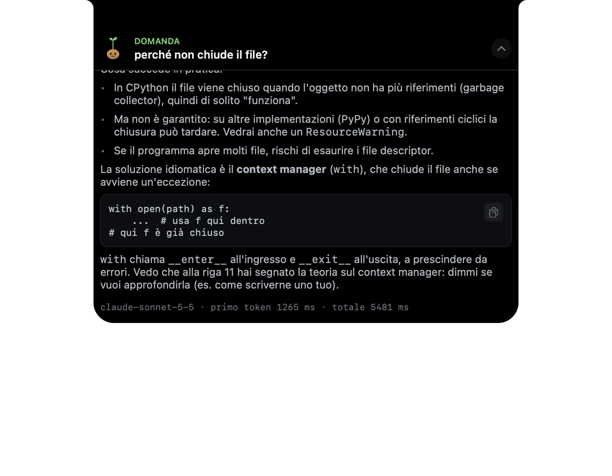

# CodeBuddy

A coding tutor that lives at the top of your screen. You write Python in PyCharm. When you have a
question, you type `#?` on its own line, and **Sprout** answers about the code in front of you. On a
Mac it appears in the notch; on Linux and Windows it uses a small panel.

**It explains and gives hints. It never writes your code.**



## What it does

| You write | You get |
|---|---|
| `#? perché non chiude il file?` + Enter | An answer about the code around that line, streamed into the panel |
| `#!teoria context manager` + Enter | A short explanation of the concept, tied to your code |
| *(nothing: you stop typing for 4 s)* | At most one small hint every 3 minutes, only when the code has changed |
| Ctrl+S (Cmd+S) | A short review of the saved file: what's wrong and one or two ways to fix it, in words |

One model does all of it: Claude through your Claude Code subscription by default. In **PyCharm →
Settings → Tools → CodeBuddy** you can pick OpenRouter or your own OpenAI-compatible server instead
(llama.cpp on this computer keeps your code local; your Mac over WireGuard works too). There are no
API keys in this repo.

## Install

Download the latest release from
[Releases](https://github.com/TheNemesis47/CodeBuddy/releases). It has builds for Windows and
Linux and the PyCharm plugin. On a Mac you build from source.

- **[INSTALL.md](INSTALL.md):** requirements (Claude Code CLI logged in, PyCharm 2026.2+, an
  optional `llama-server` for hints)
- Step-by-step guides: [Windows](docs/install/windows.md) · [Linux](docs/install/linux.md) ·
  [macOS](docs/install/macos.md)

## How it works

```
PyCharm plugin ──ws──▶ brain (Python, 127.0.0.1:8790) ──ws──▶ notch (macOS, Swift)
                         │                                  └▶ overlay (Linux/Windows, PySide6)
                         └── the model in the settings: Claude via the `claude` CLI (default),
                             OpenRouter, or your own server (llama.cpp, LM Studio…)
```

| Folder | What it is |
|---|---|
| [`brain/`](brain/README.md) | Local daemon: builds the context, picks the model, streams the answers |
| `ide-pycharm/` | Kotlin plugin: sees `#?` / `#!` lines and idle pauses, never edits your code |
| `notch/` | Swift app for the Mac notch, with Sprout |
| `overlay/` | The same panel for Linux and Windows |
| `protocol/` | JSON Schemas for the messages between the processes |
| `evals/` | Test cases and a score for the quality of the answers |

## Development

Read [AGENTS.md](AGENTS.md) first, then [docs/development.md](docs/development.md). `./scripts/check`
runs the whole gate: guards, lint, types, tests for every module and the quality floors.
[ROADMAP.md](ROADMAP.md) has the current numbers, and [docs/gaps.md](docs/gaps.md) is the work
list.

## Credits

The notch code is adapted from an MIT-licensed project; see [THIRD_PARTY.md](THIRD_PARTY.md).
